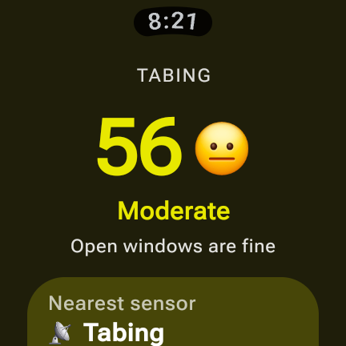
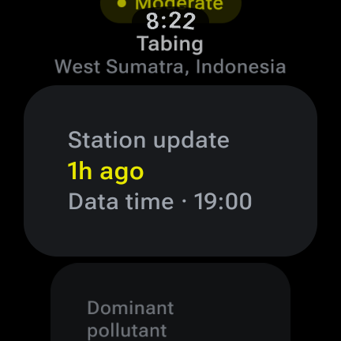
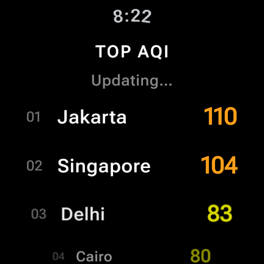
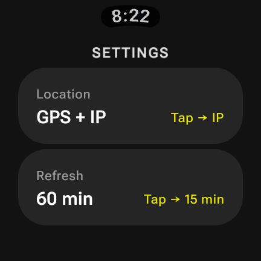
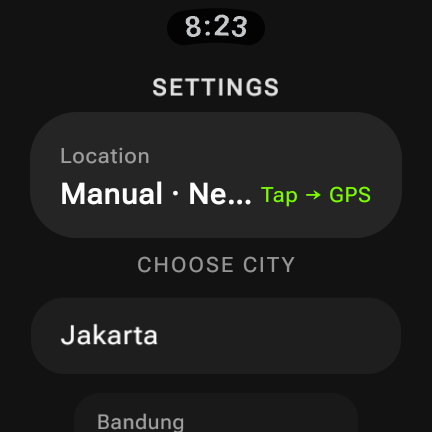
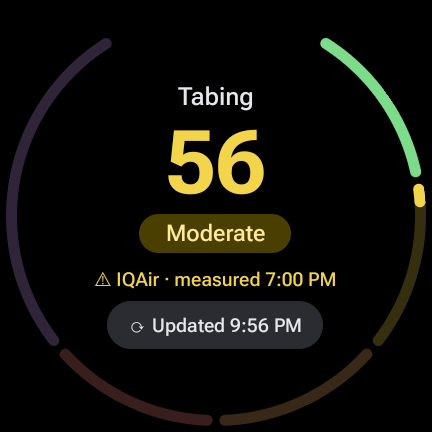

# AirWear — Design Audit & Arah Desain

> Diaudit 6 Nov 2026 di **Galaxy Watch7 (SM-L300, 432×432 px, ~203 dp, Wear OS / API 36)** via wireless ADB.
> Screenshot audit: [`docs/audit/`](docs/audit/).
>
> **Status:** desain final yang diimplementasikan ada di **§9 Redesign MD3 Expressive** — jika berbeda dengan §4–6, §9 yang berlaku.

---

## 1. Ringkasan

AirWear sudah punya fondasi yang baik: data IQAir, hero AQI berwarna, warna latar ("wash") mengikuti kategori, dan complication. Masalah utamanya ada di **hierarki informasi, pola interaksi Wear OS, dan kejujuran data**:

- Angka besar (hero) terdorong ke bawah dan **kartu "Nearest sensor" terpotong** di layar bulat.
- Settings memakai pola **"tap untuk siklus"** (GPS → IP → Manual) yang tidak terduga, bikin request API tiap tap, dan teksnya bertabrakan ("IP address Tap → MANUAL").
- Details terasa seperti **daftar kartu teks generik**: kartu besar dengan isi sedikit, label terpecah dua baris ("Dominant / pollutant"), dan section Pollutants tidak pernah muncul (paket IQAir Community tidak mengirim konsentrasi).
- Ranking menampilkan **data kota lama** (Singapore, Cairo, dll. dari cache 2 bulan lalu) dengan label "Updated just now".
- Tidak ada **page indicator**, **tombol refresh**, **Tile**, atau dukungan **rotary** di Home.

---

## 2. Temuan per layar

### 2.1 Home (`ui/home/HomeScreen.kt`) — 

| # | Temuan | Dampak |
|---|---|---|
| H1 | Konten mulai di `top = 36.dp` + nama kota + spacer; kartu sensor terpotong di bawah lengkung layar. Harus scroll untuk melihat info yang paling penting kedua (umur data). | Glanceability buruk |
| H2 | Emoji (😐 😷 ☠️) sebagai indikator utama — gaya tidak konsisten antar OEM, kesan "mainan", dan 32 sp memakan ruang horizontal. | Visual / brand |
| H3 | Nama kota di-`take(14)` lalu UPPERCASE — nama panjang terpotong mentah ("LUBUKBERGALUNG" pas-pasan). | Keterbacaan |
| H4 | Kata "Nearest sensor" + ikon 📡 + "IQAir · 1h ago" memakai satu kartu besar hanya untuk 2 info. | Ruang terbuang |
| H5 | Tidak ada cara refresh manual; status "sedang memperbarui" dan error lunak (429, offline) **tidak pernah terlihat** karena `uiState` selalu `Ready(fromCache = true)` bila ada cache. | Kepercayaan data |
| H6 | `Column.verticalScroll` → tidak ada rotary/bezel scroll, tidak ada scroll indicator. | Interaksi Wear |
| H7 | Data 1 jam lalu ditampilkan sama persis dengan data segar — tidak ada state "stale". | Kejujuran data |
| H8 | `AqiScaleRing` / `AqiProgressRing` sudah ada di `components/AqiRing.kt` tapi **tidak dipakai**. | Kode mati / peluang |

### 2.2 Details (`ui/details/DetailsScreen.kt`) — 

| # | Temuan |
|---|---|
| D1 | Header (AQI, chip, kota) bertabrakan dengan `TimeText` saat discroll; tidak memakai `ScreenScaffold` sehingga TimeText tidak menghilang/menyesuaikan saat scroll. |
| D2 | `InfoCard` = Wear M3 `Card` dengan `onClick = {}` → setiap kartu terlihat bisa diklik (ripple) padahal tidak. |
| D3 | Kartu besar dengan isi 1 nilai; label "Dominant pollutant" pecah 2 baris; "US EPA AQI" sebagai supporting text tidak bermakna bagi user. |
| D4 | Section **Pollutants tidak pernah tampil**: `pollutants_json = {}` di device. Paket Community IQAir hanya memberi `aqius`/`mainus`. |
| D5 | Koordinat mentah ("-0.876, 100.35") tidak berguna bagi user di jam. |
| D6 | Weather icon (`ic = "04n"`) disimpan tapi tidak ditampilkan. |
| D7 | Tidak ada rekomendasi kesehatan detail (masker, olahraga, jendela, kelompok sensitif). |

### 2.3 Ranking (`ui/ranking/RankingScreen.kt`) — 

| # | Temuan |
|---|---|
| R1 | Menampilkan 10 kota dari cache lama walau watch list di kode hanya 5 → entri basi tidak pernah dibuang. |
| R2 | `rankLoadedAt = now` saat cache dimuat → "Updated just now" walau datanya dari September. |
| R3 | Halaman 0 (kiri Home): swipe kanan di halaman ini = **swipe-to-dismiss keluar app** — mudah tidak sengaja. |
| R4 | Rank "01/02" pucat + AQI tanpa label kategori/warna latar; tidak ada indikator kota user sendiri dibanding dunia. |
| R5 | Daftar kota global tetap kurang relevan dibanding **kota favorit user**. |

### 2.4 Settings (`ui/settings/SettingsScreen.kt`) —  

| # | Temuan |
|---|---|
| S1 | Pola "Tap → IP" / "Tap → 15 min" = siklus tersembunyi; user tidak melihat pilihan, dan **setiap tap memicu fetch** (boros kuota 5 req/min, 500/hari). |
| S2 | Value dan hint bertabrakan ("IP address**Tap → MANUAL**", "Manual · Ne…"). |
| S3 | Label "GPS + IP" membingungkan. |
| S4 | Pengaturan Refresh **tidak berpengaruh**: WorkManager di-hardcode 30 menit (`AqiApp.kt:44`). |
| S5 | Manual city: 15 kota hardcode, tidak ada pencarian; list kota tampil inline di tengah Settings sehingga Refresh terdorong jauh ke bawah. |
| S6 | Tidak ada info versi, atribusi IQAir, status izin lokasi, atau cara menambah complication/tile. |
| S7 | Background `#121212` hardcode, beda dengan halaman lain (`#000`) → transisi pager terlihat "belang". |

### 2.5 Lintas layar

- **Tidak ada `HorizontalPageIndicator`** → user tidak tahu ada 4 halaman / posisi sekarang.
- Teks hardcode bahasa Inggris (bukan `strings.xml`); tidak ada Bahasa Indonesia.
- Dua palet warna AQI berbeda: `AqiCategory.color` vs `AqiCategory.scaleColors` (EPA). Hazardous `#B71C1C` kontras rendah di latar gelap.
- Ukuran font hardcode `sp` di banyak tempat, bukan token typography Wear M3.
- Konfigurasi berubah (rotasi/wrist) me-recreate activity → pager kembali ke Home (teramati saat audit).

---

## 3. Prinsip desain baru

1. **Glance in 2 seconds** — angka AQI, kategori, dan umur data terlihat tanpa scroll.
2. **Honest data** — selalu tunjukkan kapan data diukur; tandai *stale* (>90 menit) dan *offline* secara visual.
3. **Wear-native** — Wear Compose Material 3: `AppScaffold`/`ScreenScaffold`, `TransformingLazyColumn`, `EdgeButton`, `HorizontalPageIndicator`, rotary di semua layar yang bisa discroll.
4. **Hemat kuota & baterai** — tidak ada fetch dari interaksi yang tidak disengaja.
5. **Warna = makna** — satu palet AQI resmi, dipakai konsisten di app, tile, dan complication.

---

## 4. Struktur navigasi baru

```
              ┌────────────── HorizontalPager (+ page indicator) ──────────────┐
  [swipe-dismiss]  Home  ⇄  Detail  ⇄  Kota
                    │         │          │
                    │         │          └─ tap kota → Detail kota (SwipeDismissableNavHost)
                    │         └─ scroll: polutan, cuaca, saran kesehatan, riwayat 24 jam
                    └─ EdgeButton "Refresh" · tap ikon ⚙ → Settings (layar terpisah, bukan halaman pager)
```

- **Home jadi halaman 0** (paling kiri) → swipe kanan dari Home = keluar app (perilaku standar Wear).
- **Settings dipindah ke luar pager** (dibuka dari Home/Kota), memakai `SwipeDismissableNavHost`.
- **Ranking → "Kota"**: kota favorit user + perbandingan, bukan daftar global tetap.

---

## 5. Spesifikasi layar

### 5.1 Home

```
          ╭── 20:21 ──╮            ← TimeText
       ◜  ring skala AQI 0–300  ◝  ← AqiScaleRing di bezel (sudah ada, belum dipakai)
          Tabing ⌖                 ← lokasi (titleSmall, ellipsis tengah), ⌖ = GPS
             56                    ← displayLarge, warna kategori
          Sedang                   ← titleMedium, warna kategori
     Jendela boleh dibuka          ← bodySmall, 2 baris maks
       PM2.5 · 25° · 1 j lalu      ← labelSmall, dim; merah jika stale
        [   ⟳ Perbarui   ]         ← EdgeButton (loading state saat refresh)
```

- Emoji diganti **ikon vektor** per kategori (atau dihapus — warna + ring sudah cukup).
- Indikator kecil "offline / rate-limited" di bawah lokasi bila refresh gagal tapi ada cache.
- Long-press angka → buka Detail.

### 5.2 Detail (scroll, `TransformingLazyColumn`)

1. `ListHeader`: "AQI 56 · Sedang"
2. **Bar polutan** (PM2.5, PM10, O₃, NO₂, SO₂, CO) — bar horizontal tipis berwarna sesuai sub-indeks, polutan dominan disorot. *(Butuh sumber data konsentrasi, lihat plan.md §Fase 3.)*
3. **Riwayat 24 jam** — sparkline dari cache lokal.
4. **Saran kesehatan** — 3 baris ikon: Olahraga luar · Masker · Jendela; versi "kelompok sensitif".
5. **Cuaca** — ikon kondisi + suhu, kelembapan, angin dalam satu baris chip.
6. Footer: "Data IQAir · diukur 19:00" (label kecil, bukan kartu).

Komponen: `TitleCard`/non-clickable `Card`; **jangan** pakai `Card(onClick = {})` untuk konten statis.

### 5.3 Kota

- Baris: `[● warna] Nama kota ........ 110` + sub-label kategori; baris pertama = **lokasi saat ini**.
- Header menunjukkan umur data jujur ("Diperbarui 3 menit lalu" / "Memuat 2 dari 5…").
- Tap → Detail kota itu. Tombol "+ Tambah kota" di akhir list.

### 5.4 Settings (layar terpisah)

| Item | Komponen | Perilaku |
|---|---|---|
| Sumber lokasi | `RadioButton` list: **GPS** / **Perkiraan (IP)** / **Kota pilihan** | Fetch hanya setelah pilihan final |
| Kota pilihan | Tombol → layar pemilih kota (list + cari via `state`/`city` IQAir) | — |
| Interval refresh | Radio: 15 / 30 / 60 mnt | Benar-benar menjadwal ulang WorkManager |
| Notifikasi AQI | `SwitchButton` + ambang (Sedang/Tidak sehat sensitif/Tidak sehat) | Lihat plan.md |
| Bahasa satuan | °C/°F | — |
| Tentang | versi, atribusi IQAir, cara pasang complication & tile | — |

### 5.5 Tile (baru)

Ring AQI + angka + kategori + "1 j lalu"; tap → Home. Warna mengikuti kategori.

### 5.6 Complication

- SHORT_TEXT: `56` + ikon kategori (MONOCHROMATIC_IMAGE).
- RANGED_VALUE: 0–300 (konsisten dengan ring app), dengan `ColorRamp` palet EPA.
- LONG_TEXT: "AQI 56 · Sedang · Tabing".
- **Tanpa data → `NoDataComplicationData`**, bukan angka palsu "54".

---

## 6. Design tokens

### 6.1 Palet AQI (US EPA, disesuaikan untuk OLED gelap)

| Kategori | Rentang | Foreground | Wash (latar) | Label ID |
|---|---|---|---|---|
| Good | 0–50 | `#4ADE80` | `#0B1F12` | Baik |
| Moderate | 51–100 | `#FACC15` | `#1F1B07` | Sedang |
| USG | 101–150 | `#FB923C` | `#24140A` | Tidak sehat (sensitif) |
| Unhealthy | 151–200 | `#F87171` | `#260B0B` | Tidak sehat |
| Very Unhealthy | 201–300 | `#C084FC` | `#1B0B26` | Sangat tidak sehat |
| Hazardous | 301+ | `#FB7185` + badge | `#2A0710` | Berbahaya |

Satu sumber kebenaran (`AqiCategory`) — hapus `scaleColors` terpisah, gradient ring diturunkan dari palet ini. Semua foreground ≥ 4.5:1 terhadap wash-nya.

### 6.2 Tipografi

Gunakan token Wear M3: `displayLarge` (angka AQI), `titleMedium` (kategori), `bodySmall` (saran), `labelSmall` (metadata). Hilangkan `fontSize = xx.sp` hardcode.

### 6.3 Layout

- Gunakan `ScreenScaffold` + padding responsif dari `ScreenScaffoldDefaults`, bukan `top = 32.dp` manual.
- Target sentuh ≥ 48 dp.
- Background semua layar `#000` (OLED), wash hanya di Home.

### 6.4 Motion

- Angka AQI: `animateIntAsState` saat berubah.
- Ring: sweep animasi 600 ms saat masuk.
- Hormati *reduce motion*.

---

## 7. Copy & lokalisasi

- Semua teks ke `strings.xml`; tambah `values-in/` (Bahasa Indonesia) — default mengikuti locale jam.
- Waktu relatif via `DateUtils.getRelativeTimeSpanString` (otomatis terlokalisasi), bukan "min. ago" manual.
- Pesan error yang dapat ditindaklanjuti: "Batas permintaan tercapai · coba lagi 1 menit" bukan "Rate limited".

---

## 8. Aksesibilitas

- `contentDescription` untuk ring/ikon; angka + kategori dibaca sebagai satu kalimat ("Indeks kualitas udara 56, sedang").
- Jangan hanya mengandalkan warna — selalu ada label kategori.
- Uji dengan font scale 1.3× (Galaxy Watch default sering > 1.0).

---

## 9. Redesign MD3 Expressive (diimplementasikan)

Seluruh UI dibangun ulang dengan **Wear Compose Material 3 1.6** (Material 3 Expressive untuk Wear OS). Tidak ada lagi komponen buatan sendiri untuk hal yang sudah disediakan MD3.

### 9.1 Kerangka

| Lapisan | Komponen MD3 | Catatan |
|---|---|---|
| App | `AppScaffold` | Satu `TimeText` untuk semua layar |
| Navigasi | `SwipeDismissableNavHost` | `main` → `settings` → `settings/location` · `settings/city` · `settings/interval` |
| Halaman utama | `HorizontalPagerScaffold` + `AnimatedPage` | 3 halaman: **Kota · Home · Detail** — app dibuka di Home (tengah); swipe kiri → Detail, swipe kanan → Kota |
| Layar list | `ScreenScaffold` + `TransformingLazyColumn` | Morph saat scroll (`SurfaceTransformation`), rotary bawaan, scroll indicator |
| Aksi utama | `EdgeButton` | Home: Perbarui · Error: Coba lagi |
| List | `ListHeader`, `FilledTonalButton`, `RadioButton` | Settings memakai radio, bukan "tap untuk siklus" |

Home = halaman tengah. Swipe kanan dari halaman Kota (paling kiri) menutup app. Halaman tetangga di-pre-compose; Detail kembali ke atas begitu data masuk agar tidak terbuka dalam posisi ter-scroll.

### 9.2 Home (tanpa scroll) — versi ekspresif

```
        ◜     20:21     ◝          gauge bezel 0–300 (1 AQI = 1°), celah 60° di atas untuk TimeText
      ◟   📍 Tabing       ◞        labelMedium
             56                    numeralLarge · count-up 1,1 s (emphasized decelerate)
         ( Moderate )              pil primaryContainer
    IQAir · measured 7:00 PM       sumber + waktu ukur stasiun (⚠ + warna primary bila > 2 jam)
    ( ⟳ Updated 2 min. ago )       pil kecil ±24 dp: kapan watch terakhir mengambil data · tap = refresh
            • ○ ○                  page indicator
```

- Gauge: stroke 5 dp, 5 segmen pita EPA (track redup 22 %, terisi warna penuh sampai nilai), celah antar-segmen dihitung dari tebal stroke agar round cap tidak menyatu, penanda halo di nilai. Satu `Animatable` menggerakkan ring dan angka; ring dibaca di fase draw (tanpa rekomposisi), angka di composable terpisah.
- Dua waktu yang berbeda ditampilkan jelas: **waktu ukur stasiun** (dari IQAir) dan **waktu diambil** (download terakhir oleh watch). Label relatif diperbarui tiap 30 detik selama layar menyala.
- Pil status (bukan `CompactButton` — terlalu besar dan menutupi ring di 203 dp): normal (ikon refresh primary) · sedang refresh (spinner) · error (container merah + pesan). Area sentuh diperluas dengan padding tak terlihat.
- Tidak memakai EdgeButton (menutupi page indicator) — diuji di watch.

### 9.3 Detail (scroll)

`ListHeader` → kartu ringkasan (`primaryContainer`) → **Tips kesehatan** (olahraga, masker, jendela; berubah per kategori) → Polutan utama → Cuaca → **Sumber data** (IQAir AirVisual, stasiun, waktu ukur, waktu diambil, interval refresh otomatis) → tombol Settings → atribusi IQAir.

### 9.4 Kota

`ListHeader` + status ("Memuat 3 dari 5…" / "Diperbarui 2 mnt lalu") → baris **Lokasi Anda** (disorot) → peringkat kota: pil AQI berwarna + nama + negara.

### 9.4b Brand

- Nama aplikasi: **Air Level** (sebelumnya AirWear). `applicationId` tetap `com.airwear.aqi` agar update menimpa app lama tanpa kehilangan data.
- Ikon: cincin gauge 5 warna EPA dengan celah di atas + penanda nilai + tiga garis aliran udara, di atas lingkaran `#101216`. Bahasa visual sama dengan gauge di Home.

### 9.4c Tile



ProtoLayout (`AqiTileService`) dengan geometri gauge yang sama seperti Home (mulai jam 1, 1 AQI = 1°, celah 60° di jam 12, stroke 5 dp, 5 segmen EPA), nama stasiun, angka AQI, pil kategori, "IQAir · measured …" (⚠ bila data stasiun > 2 jam), dan pil "⟳ Updated 9:56 PM" (waktu absolut — tile tidak dirender ulang tiap menit).

- Tap di mana pun → buka app. Tap pil → `LoadAction` → refresh paksa (lewat rate limiter) lalu render ulang; error tampil di pil.
- Diperbarui otomatis setiap repository menyimpan data baru (`TileService.getUpdater`) dan minimal tiap 15 mnt (`freshnessInterval`).
- Mode GPS di background (tile, worker) memakai **fix GPS terakhir dari foreground** (maks 24 jam) karena Android tidak memberi lokasi ke app di background tanpa izin background location; sebelumnya diam-diam jatuh ke lokasi IP (kota lain).

### 9.5 Tema tonal per kategori

`ColorScheme` dibuat dari palet tonal per kategori AQI (primary / primaryDim / primaryContainer / onPrimary / onPrimaryContainer). Surface netral gelap untuk OLED.

| Kategori | primary | primaryContainer | onPrimaryContainer |
|---|---|---|---|
| Good | `#7DDC8A` | `#1E4A28` | `#B8F5C0` |
| Moderate | `#F2D54B` | `#4A3F00` | `#FFEB99` |
| USG | `#FFB46B` | `#5A3300` | `#FFDCBC` |
| Unhealthy | `#FF8A80` | `#6B1A16` | `#FFDAD5` |
| Very Unhealthy | `#D7A6FF` | `#4D2470` | `#F0DBFF` |
| Hazardous | `#FF7FA0` | `#6E1230` | `#FFD9E1` |
| Unknown | `#A8C7FA` | `#284777` | `#D6E3FF` |

Tipografi: token Wear M3 saja (`numeralLarge`, `titleMedium`, `labelMedium`, `bodySmall`, `bodyExtraSmall`). Tidak ada `fontSize` hardcode.

### 9.6 Performa (diukur di Galaxy Watch7, `dumpsys gfxinfo`, 60 Hz)

| Build | Layar | Jank (deadline missed) | p50 | p99 |
|---|---|---|---|---|
| Debug, UI lama | Detail scroll | 23.7 % | 21 ms | 53 ms |
| Release R8, UI lama | Detail scroll | 3.2 % | 11 ms | 24 ms |
| Release R8, UI MD3 (baru install) | Detail scroll | 1.9 % | 19 ms | 34 ms |
| Release R8, UI MD3 (baru install) | Kota scroll | 1.6 % | 18 ms | 22 ms |
| Release R8, UI MD3 (baru install) | Swipe pager | 3.7 % | 18 ms | 69 ms |
| Release R8, UI MD3 + AOT | Detail scroll | **0.5 %** | 11 ms | 19 ms |
| Release R8, UI MD3 + AOT | Swipe pager | 3.4 % | 13 ms | 29 ms |

Kesimpulan:
1. Penyebab utama "berat" = **debug build** (tanpa R8, debuggable). Uji performa selalu dengan release.
2. Sisa lag setelah install baru = kode belum dikompilasi AOT. Android mengompilasi sendiri di background; **baseline profile** (plan.md Fase 4) membuatnya cepat sejak install pertama.
3. Morph MD3 menambah kerja GPU (p50 GPU 4 → 7 ms) tapi tetap dalam deadline 16.7 ms.

Aturan kode: state dikumpulkan per halaman (`collectAsStateWithLifecycle`); tema hanya bergantung pada kategori AQI; pager mem-pre-compose halaman tetangga (`beyondViewportPageCount = 1`).
